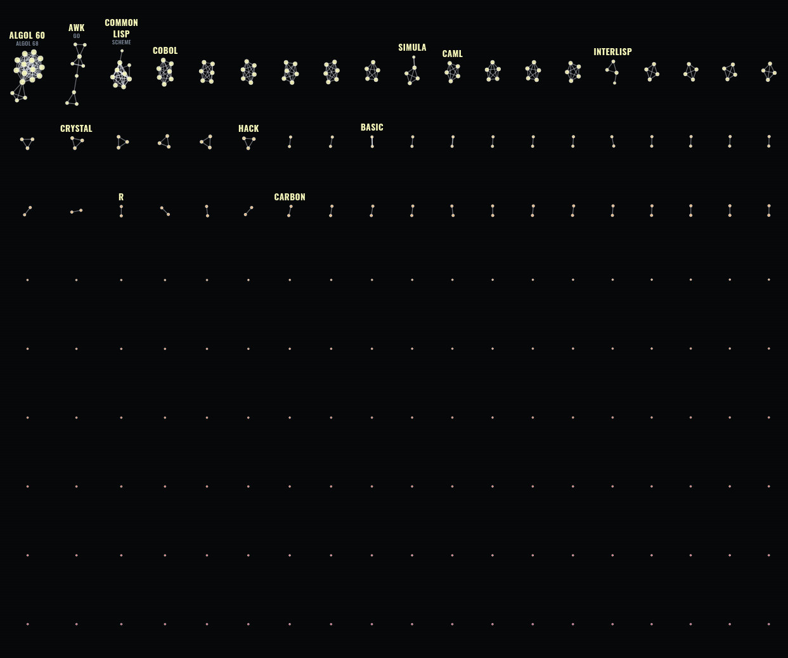

Building a programming language is mostly a solo job. Of the 1,016 programming languages in the Programming Language Database (PLDB) that name their creators, 86% list a single author.

To see how creators collaborate, we built a network from PLDB’s data, linking creators whenever they share a language. We kept only entries tagged as programming languages (pl), which gives 1,016 languages and 1,096 distinct creators. The results below are from a preliminary analysis.

Overall, the network is sparse and fragmented. Of those 1,096 creators, 739 are solo authors and the rest connect into 121 components, 114 of which are complete graphs. Most of them are small cliques. There are, however, some connected components that are not cliques. The largest is a 16-person component spanning ALGOL 60, Fortran, and Lisp. Next are 9-person components: one over B, C, Go, and awk; another over Common Lisp, Scheme, and Emacs Lisp.

The graph also helped us find duplicate names. Co-creators of a language are all linked to each other, so two names that share co-authors but never appear together are candidates for being one person under two spellings. Checking every component with a swarm of agents returned 7 confirmed same-person pairs: John G. Kemeny = John George Kemeny (BASIC), Yann Le Cun = Yann LeCun, and so on. We contributed these corrections back to the PLDB repo, and they were merged upstream, so the corrected spellings are now part of the dataset itself.

Two caveats on this. PLDB records creators for only 1,016 of its 3,460 programming languages (those tagged as 'pl'), and the rest have no creator entry at all. Also, "collaboration" means only sharing a language, which says nothing about later contributors or maintainers.